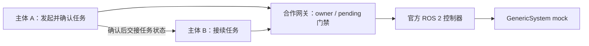

# CyberGhost
## 让任务在获授权的宿主之间接续

CyberGhost 是独立开发者的研究原型：让软件主体携带任务目标、已确认的事实和进度，在预接入、获授权的宿主之间交接，并依据设备返回的真实结果继续工作。

我们关注三个问题：动作结果未知时如何避免误判完成；交接后如何继续任务；旧控制方如何被合作网关拒绝。当前方法以明确的协议、结构化状态和手写策略为主。

**截至 2026-10-21：已完成有限软件与 ROS 2 / ros2_control mock 验证，尚未完成真实硬件实验。本仓库是公开介绍与合作入口，不是完整源码或可直接运行的开源发行版。**

## 当前验证到了哪里

最新同版实验将官方 JointTrajectoryController 与 GenericSystem mock 接入主体接续流程：

- 接续条件：A 确认第一段任务后，通过实际 peer 通信向 B 传递 1447 字节任务状态；B 根据收到的任务执行第二段。旧 A 的新请求被网关以 `owner_mismatch` 拒绝，未转发至 ROS。
- 待决条件：网关依据自身 pending 状态拒绝交接，调用方声明“没有待决任务”不能覆盖它；按原 UUID 取消后，观察到 40 个新的公开状态样本保持，无成功事实或迁移。
- 项目内独立离线验收核对源码、输入、原通信和资源生命周期，并检查六类反例。这里的“独立”指与执行和自审分开，**不是第三方认证**。

完整说明见 [软件能力与证据摘要](SOFTWARE_STATUS.md)、[阶段与失败修订](EVIDENCE_GUIDE.md)、[H/P实测事件讲解](WALKTHROUGH.md)。不同历史版本的结果不拼成同一个版本的综合能力。

这是机制示意图，不是物理连接图或实验截图。

## 明确的能力边界

当前验证使用同一容器内的独立进程和回环通信。迁移的是结构化任务状态，目标宿主预先启动；不是任意二进制跨架构迁移。compact 处理仅清除 history，不代表智能记忆压缩。

尚未证明真实网络失联、设备驱动及固件授权、DDS 旁路隔离、真实制动安全、任意机器人接入或跨协议控制。控制权交接必须得到设备所有方与实际接口的认可。本项目不以未授权接管设备为目标。

## 寻找设备与接口合作

希望与浙江、上海及可提供受监督远程实验的团队合作，优先明确具体设备接口，再安排小范围实机验证。

目前需要：

- 可提供文档与测试权限的桌面机械臂、低能量执行机构或类似平台；
- 设备驱动、ROS 2 / ros2_control 接口、取消和失联行为的技术评审；
- 有现场负责人及独立停止手段的短时实验机会，或合适团队的转介。

首轮拟从只读状态、禁能接口检查开始，再由设备方共同批准有限无负载动作。速度、行程、停止判据与责任约定依据具体设备确定，不沿用 mock 的数值当作物理安全标准。

合作目标是回答软件无法回答的问题：同一设备上，单宿主基线与授权交接后的任务接续，实际反馈、停止行为和恢复成本有何差异。当前没有已获硬件或实验场地的承诺。

**联系：yujin / 余烬 · 独立开发者**  
杭州；可到浙江、上海。邮箱：[vennai26@163.com](mailto:vennai26@163.com)

欢迎先交流设备型号、公开接口资料、可用测试方式及成本条件。请勿在公开 Issue 中提交设备凭据、个人证件或受限资料。

## 资料状态

原研究仓库保持私有，保留完整实验与失败记录。本仓库只发布整理后的介绍和证据摘要；摘要不能替代第三方复现。最小可复现代码的发布范围、依赖与许可证仍待单独核定，本次不授予未发布源码的开源许可。
