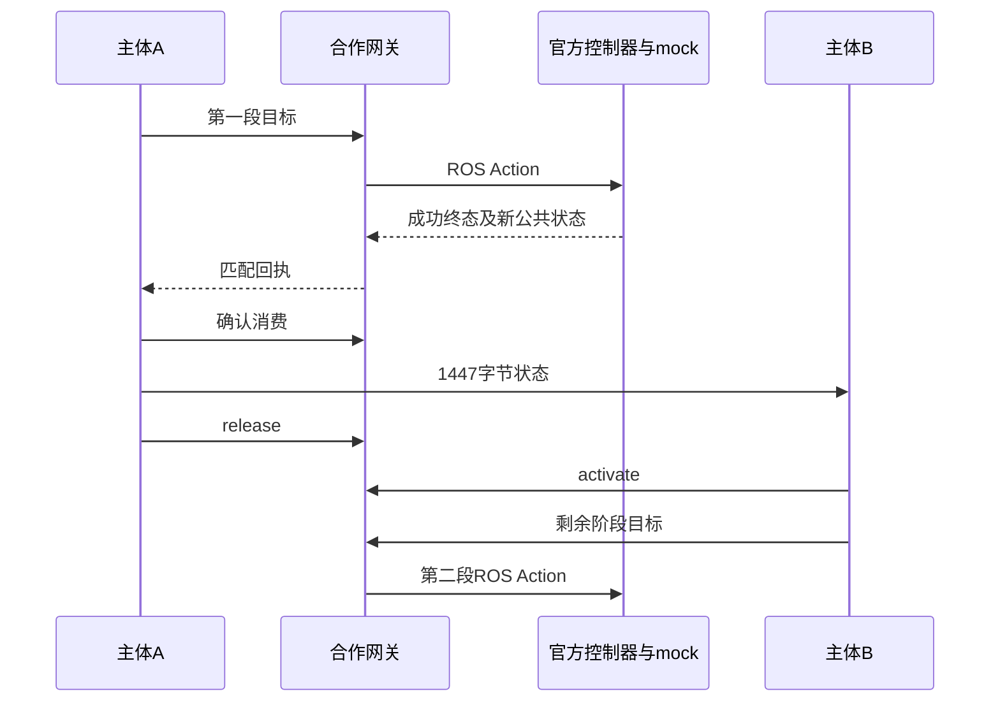

# 两条实测任务：确认后接续，待决时停止交接

证据阶段：2026-10-21 control-subject / attempt-01。以下是已验收事件的脱敏讲解，省略原始标识和精细时钟；顺序表示因果，不表示按比例时间轴。

## H：第一段确认后交给B

| 顺序 | 实际事件 | 含义 |
|---|---|---|
| 1 | A请求两个mock关节两秒到[0.15,-0.10] | 接单不算完成 |
| 2 | 官方控制器SUCCEEDED/error0，终态后10个新公共状态达标 | 终态与实际公开状态共同取证 |
| 3 | A收到匹配回执后写事实和进度，再确认消费 | 设备完成与主体知道完成不同 |
| 4 | A向B实际发送1447字节任务状态，发送/接收/激活内容一致 | B启动没有任务答案 |
| 5 | prepare→release→activate，owner从A经空位变B、epoch1 | 不允许两个逻辑控制者同时提交 |
| 6 | B执行收到的剩余目标[0.30,-0.20]，成功终态后11个新样本达标 | 接续第二段任务 |

B激活后，旧A还发出新动作标识、参数合法的请求，网关以owner_mismatch拒绝，未向ROS转发；该探针没有第三个控制器目标。

图仅展示主要因果，完整交接还有准备授权与准备确认，不能按简图实现协议。

## P：动作待决，不能交接

A发出十秒目标[0.8,-0.6]后，在执行期间声称pending为空并申请交接；网关依据自己的待决记录拒绝。

随后对原UUID请求取消，分别核对取消响应和CANCELED终态；等至少0.5秒后再观察两秒，40个新样本保持，最后mock位置约[0.0831971,-0.0623978]，未到原目标。owner仍A/epoch0，无迁移、B动作或成功进度。

这说明本版此输入下没有把取消误记为成功，也没有越过待决门禁。mock没有惯性、负载或碰撞模型，不能据此推断真实制动安全。

## 实验与未验证项

控制器、网关、A/B是同容器内进程。迁移的是结构化状态，不是任意程序；未测试跨机器网络、故障重启、底层身份安全或任意设备接入。

[软件能力摘要](SOFTWARE_STATUS.md) · [版本与证据说明](EVIDENCE_GUIDE.md)